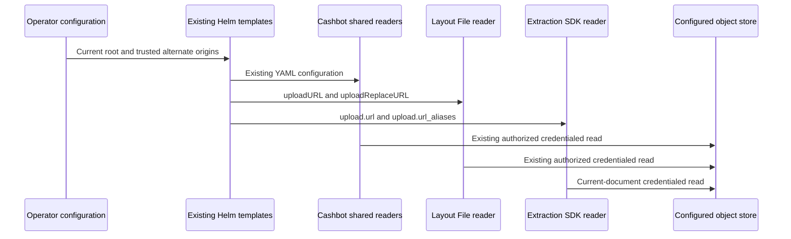

# Configured file aliases across services

## Context and source

Remote default refs verified on 2026-10-28. These are research baselines, not new runtime pins.

| Repo | Pushed ref | Owning code |
| --- | --- | --- |
| groundx-python | `fa5164f97e2bd83fa9527b42f9649119b36a4a70` | `src/groundx/extract/settings/settings.py`, `services/upload.py`, `classes/document.py` |
| internal-arcadia-agents | `04b5e971f3e16d38d454871d93196d1b1bfc69f8` | `classes/statement.py:_agent_images_for_review`, `classes/image_evidence.py` |
| cashbot-go | `1a1790b368329f9003661ea68a5c288767764e90` | `pkg/config/upload.go`, `pkg/fileaccess/config.go`, `pkg/utility/{stored_source,url}.go`, `pkg/prompt/multimodal.go` |
| ai-server | `1b28e5239cffe2afc39b77a028d7121e97174b1a` | `document/classes/file.py:File.storageKey`, `document/util.py:GetFileFromBucket` |
| groundx-on-prem | `76f45ea768602d723168896643c8e2cd917c3a5f` | `src/groundx/templates/_helpers/services/file.tpl`, `resources/{config-yaml,layout-config-py,extract-config-py}.yaml` |
| groundx-studio-harness | `e965ea98b75eebe26052717e64d9e5c9d6ca040d` | architecture trust, on-prem file-access and extraction storage references |

Arcadia's current hostname test excludes a supported older page/crop host. Its validator and key converter independently use only `upload.url`. Cashbot's `UploadRoots` accepts `TrustedOrigins`, but `StoredSourceKey`, `IsInternalURL` and `RemoveBaseURL` enumerate current/native roots separately. Layout already resolves a list of trusted roots correctly. Helm currently forwards `trustedOrigins` to Cashbot only when the gateway is enabled and forwards no alias list to extraction.

Prior contracts: SDK active `protect-hosted-file-access` design and `extract-protected-file-consumers` spec; Arcadia archived `2026-10-28-use-owned-image-storage`; Cashbot active `verify-cloud-file-access` and archived `2026-10-27-protect-hosted-file-access`; ai-server and Helm active `protect-hosted-file-access`. Keep strict request parsing separate from legacy saved-filename parsing. In particular, layout's existing owned query-bearing filename interpretation is not replaced with the SDK native-grant classifier.

## Configuration and persistence

Keep one operator alias input: `fileAccess.trustedOrigins`. It remains a list of HTTPS origins for the same primary storage namespace, with its existing bounds. Validate this list even when protection is disabled; do not run enabled-only private-origin/TLS/credential gates in that case. Empty aliases preserve old configuration. Do not add another operator alias registry, database table or runtime discovery call.

```yaml
# On-prem values, example addresses only.
fileAccess:
  enabled: false
  trustedOrigins: [https://old-files.example.com]
```

Helm's existing file helper derives presentation and native roots. Extend it with `groundx.file.urlAliases`, accepting the existing root/settings dictionary and returning a deduplicated JSON list of complete alternate file roots. It includes the native bucket root and configured aliases. Use the current backend's bucket-path rule: S3 preserves the root; MinIO/S4 appends `/<bucket>` only when absent. Do not discard a configured delivery prefix. Only include primary-store aliases for matching backend, native endpoint, bucket and region; a separate `extract.file` store retains its own current/native roots.

| Consumer | Rendered configuration | Persistence |
| --- | --- | --- |
| Cashbot API/workers/gateway | Existing `upload` and `fileAccess.trustedOrigins`; emit a disabled fileAccess alias block when aliases exist without a gateway | Existing `config-yaml-map` Secret, `config.yaml` |
| Layout | Existing `uploadURL`; shared aliases in `uploadReplaceURL` | Existing layout `*-config-py-map` Secret, `config.py` |
| Extraction | Existing `upload.url`; shared aliases in new optional `upload.url_aliases` | Existing extraction `*-config-py-map` Secret, `config.py` |

Hosted Cashbot continues loading its saved YAML from the existing S3 release path. Hosted layout/extraction continue using their existing mounted runtime configuration. Before changing hosted configuration, identify its actual backing resource and show the sanitized exact diff. Do not assume every cloud container uses S3 or Secrets Manager. Configure hosted aliases there, not in code defaults. This plan creates no configuration resources.

## Cashbot Go

Add `func (u Upload) FileRoots(f FileAccess) []string` in existing `pkg/config/upload.go`. Move the root-list construction from `fileaccess.UploadRoots` there and reuse `u.bucketURL` for exact-once bucket suffix handling. Keep `UploadRoots` as the existing adapter that attaches `UploadStorageIdentity` to each URL. This avoids an import cycle from utility into fileaccess and adds no new package or config field.

```diff
 // pkg/fileaccess/config.go, proposed outline
- construct presentation/native/gateway/alias URL list here
+ for _, root := range u.FileRoots(f) {
+     roots = append(roots, Root{URL: root, StorageIdentity: identity})
+ }

 // pkg/utility/stored_source.go and url.go
- inspect only Upload/UploadGroundX BaseURL and BucketURL
+ inspect those stores' shared FileRoots lists
- replace every occurrence of a matched root
+ remove only the longest matching leading root at a path boundary
```

Retain the exported utility signatures. Place any common utility prefix matcher beside `StoredSourceKey`, rather than adding another file. `IsInternalURL`, `RemoveBaseURL`, `StoredSourceKey` and `SwapBucketURL` must agree about configured aliases. Preserve caller-specific behavior for relative keys, native grants, external URLs and legacy filenames; do not replace `Resolver.CanonicalStoredURL` with a stricter request parser. Extra primary aliases must not be blanket-assigned to `UploadGroundX` when it represents another storage namespace.

```text
gateway or enabled internal image read:
    UploadRoots -> existing Resolver -> current binding/owner/policy checks
    authorized key -> existing storage client
    denial or lookup failure -> existing error, never anonymous retry

legacy utility/source read:
    same configured root list -> existing strict key/filename contract
    existing caller authorization -> existing storage client

signed URL:
    existing signed transport, no root stripping or service-credential fallback
```

`pkg/prompt/multimodal.go` and `pkg/ratelimit/request_passthrough_images.go` must use the existing image authorizer when present. For legacy reads without it, route existing key derivation through the shared utility; do not create a second authorization mechanism or change provider payload sizing. Lambda and server adapters keep using these same packages.

## SDK and extraction

Add `url_aliases: List[str] = Field(default_factory=list)` to `ContainerUploadSettings`. Validate roots before I/O. Add `Upload.storage_key(reference: str) -> Optional[str]` in `services/upload.py` and reuse `services.http.is_native_signed_url`; do not copy its signature detector into Arcadia. Return the exact root suffix for an owned reference, `None` for a native grant or external URL. Leave existing `get_object` signatures and the S3/MinIO/S4 adapter selection intact.

```text
storage_key(reference):
    signed grant -> None
    validate authority and match configured url + url_aliases, longest first
    accept existing historical HTTP equivalent for internal reads only
    require full root/path boundary
    return exact remaining key, or None

prepare image:
    signed -> exact bounded HTTP GET, no privileged retry
    owned -> existing current task/document/original check -> native client read
    external -> existing approved external transport
    provider -> existing inline bytes or supported Bedrock S3 transport
```

Replace Arcadia's hostname test, private validator's root removal, `_image_storage_path` and Bedrock HTTP-to-S3 key conversion with this resolver. Compare original-source identity by resolved key within the configured store, so alternate roots cannot fail an otherwise valid original check. Keep task/document checks and generated-page namespace checks. `public_read` remains provisioning configuration, not an ownership or provider-delivery decision. Remote HTTP host allowlists do not authorize native storage reads.

`DocumentRequest.load_images` uses the same resolver before the existing service-client shortcut. Explicit authenticated presentation still uses `bounded_file_get`; it must never be converted into a privileged read after a denial. Unowned references retain their existing external path. Extend adapter tests if a supported exact key exposes a normalization discrepancy; do not alter object names or rewrite saved links to hide it.

All SDK edits stay in existing `.fernignore` paths (`src/groundx/extract`, `tests/extract`, `openspec`, CONTRIBUTING/CHANGELOG). No generated client, Fern schema, package version or TypeScript change is needed.

## Layout, other consumers and documentation

Reuse ai-server `File.storageKey`, `File.uploadURL`, hashed-first `readPaths` and `GetFileFromBucket`. Only its rendered alias list and contributor documentation need alignment unless a production-reader test proves a further defect. Do not introduce an SDK dependency into ai-server. Keep `uploadReplaceURL` string compatibility and its existing filename semantics.

Workspace runner operates on workspace files and does not read these extraction image objects. Dashboard, middleware and generated SDKs continue using returned URLs unchanged. MCP permissions and file-link issuance are unchanged. Update existing Cashbot file-access guidance, SDK CONTRIBUTING, ai-server config guidance, Helm operator guide and Harness architecture/on-prem/extraction references with the same configuration-to-reader map. Sync generated public Harness content through its normal process, without a new scanner or CI job.



## Validation, cost and release

Extend existing Go URL/resolver/image tests, SDK upload/document tests, Arcadia image/statement tests, layout reader tests and Helm render cases. Cover current/alias mixed documents, both gateway modes, lookalike roots, explicit ports, overlapping prefixes, exact filename bytes, bucket paths, wrong owners, native grants and denied reads. Assert actual keys and provider-bound image content, not only helper calls. Public and protected extraction of identical bytes must select/prepare the same images under the same budget. Keep existing sizing/deduplication and fixture expectations.

The current repro is mixed-host ADP PDF; PNG/JPG originals must also pass. Required existing boundary replay surfaces are Arcadia legacy, Arcadia v1, generic v1 and ADP v1. They share runtime image handling, so run the maintained compact replays plus production image-preparation tests; a replay that stubs image preparation does not prove transport. Use normal CI only. Local S3/MinIO/S4 key-contract tests do not claim live vendor certification; live on-prem rollout remains deferred, independently of cloud acceptance.

Cost: a small per-reference root scan, SDK release and image rebuilds, plus authorized worker image reads already intended by the owned-image design. No Redis additions, SQL queries, migrations, infrastructure or IAM changes. Unknown aliases remain external until declared; configuration must be inventoried rather than automatically trusting incoming hosts.

Order: compatible SDK release by its human owner; Cashbot and extraction builds; compatible images before Helm/configuration using aliases; dev mixed-root public/protected extraction and all returned-link readback; explicit approval for hosted rollout. Roll one worker group at a time with no global pause. Record exact prior images/config versions and restore only those on failure; preserve private bucket policies and stored links. Archive implementation changes in their implementation PRs after evidence and local-artifact closeout, not through follow-up bookkeeping PRs.

Before future runs, initialize the owning repo's bounded local-work lifecycle through the installed manual linked-repository procedure. Current planning has created no raw run artifacts. No production mutation or new infrastructure is authorized by this document.
